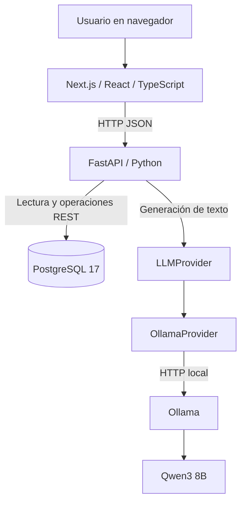

# AI Operations Assistant

**Asistente de operaciones empresariales con inteligencia artificial local, API en Python e interfaz web.**  
*Local-first AI operations assistant built with Next.js, FastAPI, PostgreSQL and Ollama.*

> **Estado:** desarrollo activo · **Hito:** Día 12/60 · **Plan:** 12 semanas / 240 horas · **Tipo:** proyecto personal de portafolio.
>
> El alcance de esta versión corresponde a la implementación local reportada hasta el Día 12. Se identifican explícitamente las funcionalidades que todavía están pendientes de pruebas o integración.

## Objetivo

Centralizar la consulta y gestión de información operativa ficticia —clientes, pedidos y tickets de soporte— en una aplicación web. El objetivo progresivo es permitir que el usuario interactúe con estos datos en lenguaje natural mediante un asistente con herramientas, acceso controlado y trazabilidad.

Este proyecto prioriza **integración funcional, código mantenible, pruebas, documentación y seguridad** antes que incorporar frameworks o características innecesarias.

## Demostración: chat con un LLM local

El hito principal del Día 12 es la conexión de la interfaz web con un modelo local:

1. El usuario escribe en el chat de **Next.js**.
2. El frontend envía un `POST /chat/llm` a **FastAPI**.
3. FastAPI invoca el contrato `LLMProvider`, implementado por `OllamaProvider`.
4. **Ollama** ejecuta **Qwen3 8B** y genera una respuesta.
5. El backend devuelve un JSON con `reply`; la interfaz muestra la respuesta y el estado de carga.

Esta integración se reportó como funcional en desarrollo local. **El modelo todavía no consulta por sí mismo la base de datos ni ejecuta herramientas**: esas capacidades pertenecen a hitos posteriores.

### Arquitectura



La aplicación se desarrolla en **Bazzite Linux**. PostgreSQL y Ollama se ejecutan mediante **Podman**; Ollama se administra con **Quadlet/systemd**. Next.js y FastAPI se ejecutan como procesos de desarrollo separados.

## Stack tecnológico

| Capa | Tecnología | Responsabilidad |
| --- | --- | --- |
| Frontend | Next.js, React, TypeScript | Interfaz web, chat, estado de carga |
| Backend | FastAPI, Python, Pydantic | API REST, validación y coordinación |
| Datos | PostgreSQL 17, SQLAlchemy | Clientes, pedidos, tickets |
| LLM local | Ollama, Qwen3 8B | Generación de respuestas |
| Integración | `LLMProvider`, `OllamaProvider`, `httpx` | Separación del proveedor e HTTP asíncrono |
| Entorno | Bazzite Linux, Podman, Quadlet, systemd | Servicios locales |
| Calidad | pytest; TypeScript y build de Next.js | Pruebas y comprobaciones de compilación |

## Funcionalidades

| Capacidad | Estado |
| --- | --- |
| API REST para listar clientes, pedidos y tickets desde PostgreSQL | Implementada |
| Consultas individuales de clientes, pedidos y tickets | Implementadas |
| Creación y actualización de tickets mediante API | Implementadas según informe local del Día 9 |
| Interfaz web con vistas operacionales y chat | Implementada según informe local |
| Chat Next.js → FastAPI → Ollama → Qwen3 8B | Implementado; respuesta real comprobada manualmente |
| Abstracción `LLMProvider` y adaptador `OllamaProvider` | Implementados según informe local del Día 12 |
| Manejo de carga y errores en el chat | Implementado según informe local |
| Pruebas del LLM con mocks; pruebas automatizadas del frontend | Pendientes |
| Agente con herramientas de consulta a PostgreSQL | Pendiente |
| RAG con pgvector, MCP y memoria persistente | Pendientes |
| Aprobación humana y auditoría de operaciones del agente | Pendientes |

**Progreso del plan:** 12 de 60 días abordados (20 % del calendario). Este porcentaje **no representa** el avance funcional ni la cobertura de pruebas.

## Estructura del repositorio

```text
ai-operations-assistant/
├── apps/
│   └── api/
│       ├── app/
│       │   ├── api/                 # Endpoints: customers, orders, tickets, chat
│       │   ├── agent/
│       │   │   ├── core/model.py    # Contrato LLMProvider
│       │   │   └── providers/ollama.py
│       │   ├── database.py
│       │   └── main.py
│       ├── tests/
│       └── requirements.txt
├── frontend/                      # Interfaz Next.js / TypeScript
│   └── src/components/ChatWindow.tsx
├── database/
│   ├── migrations/
│   └── seeds/
└── README.md
```

> Esta estructura recoge el código reportado en el entorno local hasta el Día 12. Antes de publicar este README, se deben incorporar al mismo commit o secuencia de commits los cambios correspondientes del frontend y del backend.

## Ejecución local (entorno de desarrollo)

### Requisitos

- Podman, con los servicios del proyecto previamente configurados.
- PostgreSQL 17 y Ollama con el modelo `qwen3:8b` disponible.
- Python y dependencias del backend instaladas en un entorno virtual.
- Node.js y npm, con las dependencias del frontend instaladas.

Los comandos están orientados a la máquina de desarrollo utilizada en el proyecto; **no constituyen una guía de despliegue productivo**.

### 1. Iniciar PostgreSQL y Ollama

```bash
podman start ai-operations-postgres
systemctl --user start ollama.service

# Verificar disponibilidad de Ollama
curl http://127.0.0.1:11434/api/tags
```

El servicio `freellmapi.service` se administra por separado, si es necesario. No está acreditado como parte del recorrido actual Next.js → FastAPI → Ollama.

### 2. Iniciar la API FastAPI

Abre una terminal:

```bash
cd ~/projects/ai-operations-assistant/apps/api

# Activa el entorno virtual usado en tu instalación.
# Ejemplo si existe dentro de apps/api:
source .venv/bin/activate

python -m uvicorn app.main:app --reload --host 127.0.0.1 --port 8000
```

- Documentación interactiva: <http://127.0.0.1:8000/docs>.
- Si la ruta del entorno virtual es distinta, ajusta el comando `source`.
- En una instalación limpia hay que instalar las dependencias definidas en `apps/api/requirements.txt` y configurar la conexión a PostgreSQL antes de iniciar.

### 3. Iniciar Next.js

Abre otra terminal:

```bash
cd ~/projects/ai-operations-assistant/frontend
npm install  # necesario la primera vez o tras cambios de dependencias
npm run dev
```

- Chat: <http://localhost:3000/chat>, si Next.js utiliza su puerto predeterminado.
- La aplicación web se comunica con **FastAPI**, no directamente con Ollama.
- La URL de FastAPI debe coincidir con la configuración del frontend; su consolidación en variables de entorno sigue pendiente.

### 4. Verificar el chat por HTTP

```bash
curl -X POST http://127.0.0.1:8000/chat/llm \
  -H 'Content-Type: application/json' \
  -d '{"message":"Hola, ¿qué puedes hacer?"}'
```

Contrato de respuesta:

```json
{
  "reply": "Respuesta generada por Qwen3"
}
```

El texto real variará entre ejecuciones.

### 5. Detener los servicios

Detén FastAPI y Next.js con `Ctrl+C` en sus terminales. Si ya no los necesitas:

```bash
systemctl --user stop ollama.service
podman stop ai-operations-postgres
```

Si los ejecutas mediante unidades temporales de systemd, detén esas unidades en lugar de `Ctrl+C`. Estos comandos no alteran la configuración de arranque automático.

## Endpoints destacados

| Método | Endpoint | Uso |
| --- | --- | --- |
| `GET` | `/health` | Comprobación básica de la API |
| `GET` | `/customers/` | Listar clientes |
| `GET` | `/customers/{customer_id}` | Consultar un cliente |
| `GET` | `/orders/` | Listar y filtrar pedidos |
| `GET` | `/orders/{order_id}` | Consultar un pedido |
| `GET` | `/tickets/` | Listar tickets |
| `GET` | `/tickets/{ticket_id}` | Consultar un ticket |
| `POST` | `/chat/llm` | Consultar Qwen3 mediante FastAPI |

Hay operaciones adicionales de tickets según el estado local del Día 9. Para confirmar el catálogo y los esquemas vigentes, consulta `/docs` en la versión del backend que estés ejecutando.

## Pruebas y verificación

Desde el entorno Python del backend:

```bash
cd ~/projects/ai-operations-assistant/apps/api
python -m pytest -q
```

Desde el frontend:

```bash
cd ~/projects/ai-operations-assistant/frontend
npx tsc --noEmit
npm run build
```

**Evidencia reportada al Día 12:** generación real de una respuesta de Qwen3 desde FastAPI mediante una prueba manual; pruebas previas de API con pytest. **Por confirmar:** pruebas automatizadas con mocks para `LLMProvider`, pruebas de frontend, compilación actual de Next.js y ejecución de la suite completa tras integrar los cambios. Aquí no se inventan resultados de pruebas.

## Decisiones y seguridad

- **Inferencia local:** Ollama opera como servicio independiente; el navegador nunca necesita contactar directamente con el modelo.
- **Modularidad:** el contrato `LLMProvider` permite aislar la integración del modelo de las rutas de la API.
- **Datos de desarrollo:** clientes, pedidos y tickets pertenecen a un escenario ficticio.
- **Manejo de errores:** se reporta validación de solicitudes y tratamiento de errores cuando Ollama no está disponible.
- **Configuración y secretos:** sigue pendiente centralizar las URLs, credenciales y selección del modelo en variables de entorno. No se deben publicar contraseñas ni usar credenciales de desarrollo en producción.
- **Escrituras realizadas por IA:** toda operación futura que modifique datos deberá requerir aprobación humana explícita y quedar registrada. **Aún no se ha implementado.**

## Hoja de ruta

1. Cerrar la validación del Día 12 y sincronizar frontend, backend y documentación con GitHub.
2. Añadir herramientas **de solo lectura** que permitan al agente consultar PostgreSQL.
3. Incorporar recuperación documental con **RAG + pgvector**.
4. Integrar **MCP** y manejo básico de contexto conversacional.
5. Implementar aprobación humana, registro de auditoría, evaluación y una demo reproducible.

## Capturas y demo

Pendiente incorporar capturas reales de la interfaz web, de `/docs` y una demostración corta del flujo Next.js → FastAPI → Qwen3. No se utilizan capturas ni métricas ficticias.

---

**Proyecto personal de portafolio en desarrollo.** Busca demostrar habilidades de ingeniería de software, integración full-stack y sistemas de IA con un alcance realista y verificable.
